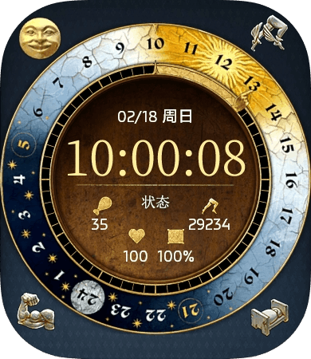

# 天国拯救2非官方表盘

# 功能
- ## 已支持
  - 健康数据显示:卡路里、心率、电量、步数
  - 24时盘随时间旋转
  - 秒进度环带有材质和手指 (刻度是60刻度，游戏是48刻)
  - 左上角的脸可以点击切换；每次开屏时会自动按电量切换
  - AOD显示
- ## 未实现
  - 功能区跳转（手表不让跳）
  - 自定义字体（手表不认，现有的是svg轮播）
  - 编辑（没想好编辑什么）
- ## 设备支持
  - vivo/iqoo watch GT

## 安装
下载rpk文件，使用[orbitV](https://orbitv.top/)安装
# 从源码编译
克隆本项目，下载安装并使用[BlueOS Studio](https://studio.blueos.com.cn/)打开项目文件夹，点击右上角打包按钮，使用默认的release和 production即可。产物在项目文件夹的dist里
## 可能有用的信息
### rpk解包
 表盘文件rpk可以直接使用压缩工具打开并解压缩，里面的vru文件是vivo自创格式，可以使用本项目tools内的[解包脚本](tools/vru_extract.py)解开（感谢ai发力）使用为 `python vru_extract.py xxx.vru  out`，同时也有一个c语言版本的，使用vs开发终端cd到.c文件所在路径直接`cl vru_extract.c`编译即可获得exe产物，可将windows文件打开方式设为此exe
### 素材来源
找到`KingdomComeDeliverance2\Data\IPL_GameData.pak`使用压缩工具打开
| 路径                                                    |      内容      |
| :------------------------------------------------------ | :------------ |
| `IPL_GameData.pak\Libs\UI\Textures\SkipTime\`           | 时间盘主体素材 |
| `IPL_GameData.pak\Libs\UI\Textures\pak\Icons\RPG`       |    一些图标    |
| `IPL_GameData.pak\Libs\UI\Textures\Apse\reputation.dds` |      脸图      |

可以使用免费的[Paint.NET](https://paint.net/download.html)来打开dds文件并提供dds文件的预览功能